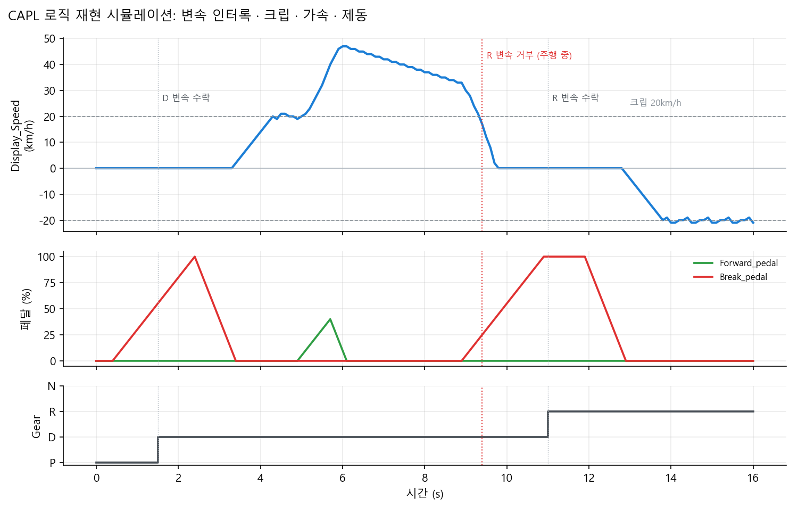

# CANoe·CAPL 차량 제어 시스템

CANdb++로 설계한 네트워크에서 Driver 노드와 Vehicle_ECU 노드를 CAPL로 구현한 가상 차량 시뮬레이션입니다. (2025.07, 개인 프로젝트)

| 파일 | 내용 |
|---|---|
| `VehicleNetwork.dbc` | 노드·메시지·시그널 정의 |
| `Driver.can` | 키보드 입력(p/r/n/d 기어, a 가속, b 브레이크, m 주행모드) → GearControl, Driver_input 송신, Speed 수신·표시 |
| `VehicleECU.can` | 입력을 받아 100ms마다 속도·연비 계산 → Speed 송신 |

## 메시지
| 메시지 (ID) | 방향 | 시그널 |
|---|---|---|
| GearControl (0x100) | Driver → Vehicle_ECU | Gear (0=P, 1=D, 2=R, 3=N) |
| Speed (0x200) | Vehicle_ECU → Driver | speed_signal, Fuel_Efficiency (×0.1), Display_Speed (signed, ×0.1) |
| Driver_input (0x300) | Driver → Vehicle_ECU | Forward_pedal, Break_pedal, Drive_mode |

## 제어 로직
- 브레이크를 밟은 상태에서만 변속 요청, 주행 중(속도 ≠ 0)에는 ECU가 변속 거부
- 브레이크 우선, D 최고 250km/h / R 최고 100km/h, 20km/h까지 크립 주행
- Eco / Standard / Sport 모드별 가속·연비·제동 파라미터

> 원본은 CP949였던 파일을 GitHub에서 읽을 수 있도록 UTF-8로 변환했습니다. (`/*@!Encoding:65001*/`)

## 로직 재현 시뮬레이션 (`tools/`)



`Driver.can`·`VehicleECU.can`의 계산식(페달 램프, 크립·가속·제동, 모드별 파라미터, 주행 중 변속 거부)을 Python으로 그대로 옮겨 시나리오를 돌린 결과입니다. CANoe 측정 화면이 아니라 동작을 확인하기 위한 재현입니다.

```bash
pip install matplotlib
python tools/simulate_vehicle.py
```
