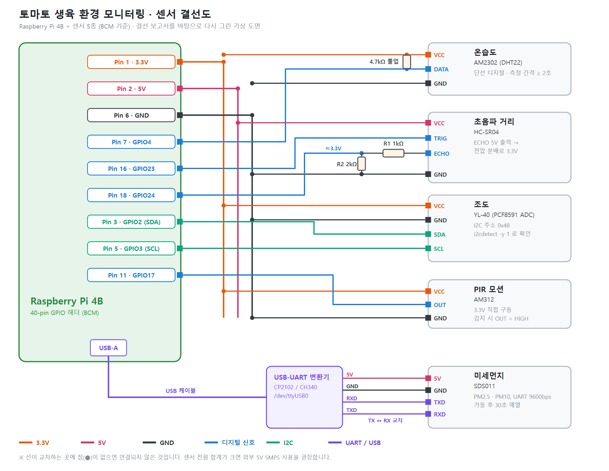
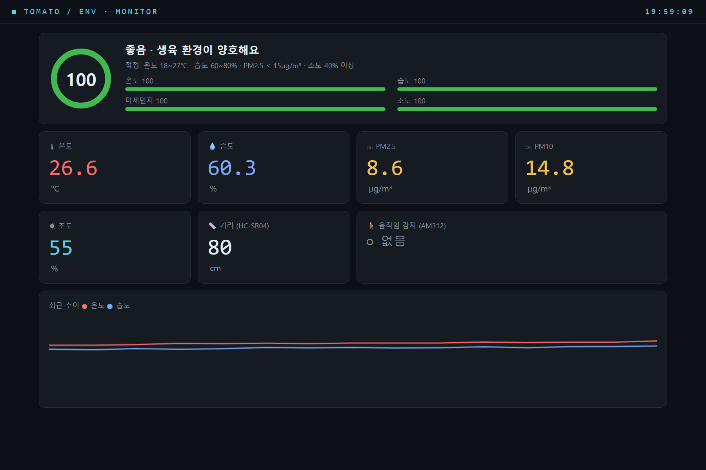

# 라즈베리파이 기반 토마토 생육 환경 모니터링

라즈베리파이 4B에 환경 센서 5종을 GPIO·I2C·UART로 연결해 토마토 재배 환경을 측정하고, Flask 웹 대시보드로 실시간 표시합니다. 측정값으로 생육 환경 점수(0~100)를 계산하고, 적정 범위를 벗어난 항목은 조치 메시지를 보여줍니다.

## 센서 결선



| 센서 | 모델 | 측정 | 연결 (BCM) | 비고 |
|---|---|---|---|---|
| 온습도 | AM2302 (DHT22) | 온도, 습도 | DATA → GPIO4 (Pin 7) | 4.7kΩ 풀업, 측정 간격 2초 이상 |
| 미세먼지 | SDS011 | PM2.5, PM10 | USB-UART → /dev/ttyUSB0 | 5V, 예열 30초 |
| 초음파 | HC-SR04 | 거리 | TRIG → GPIO23 (Pin 16), ECHO → GPIO24 (Pin 18) | ECHO는 1kΩ+2kΩ 전압 분배로 3.3V |
| 조도 | YL-40 (PCF8591) | 빛의 세기 | SDA → GPIO2 (Pin 3), SCL → GPIO3 (Pin 5) | I2C 0x48 (`i2cdetect -y 1`로 확인) |
| PIR | AM312 | 움직임 | OUT → GPIO17 (Pin 11) | 3.3V 직접 구동 |

전원: SDS011, HC-SR04는 5V(Pin 2/4), AM2302, YL-40, AM312는 3.3V(Pin 1/17)

## 구조
- `sensors.py`: 센서별 읽기 클래스. 센서 하나가 빠져 있어도 나머지는 계속 동작
- `app.py`: 2초마다 센서를 읽는 백그라운드 스레드, 생육 점수 계산, `/api/data` JSON API
- `templates/index.html`: 점수 링, 센서 카드, 온·습도 추이 그래프 대시보드

## 대시보드



*센서 없이 모의 데이터(`TOMATO_MOCK=1`)로 실행한 화면입니다.*

## 생육 점수 기준
| 항목 | 적정 범위 |
|---|---|
| 온도 | 18~27°C |
| 습도 | 60~80% |
| PM2.5 | 15µg/m³ 이하 |
| 조도 | 40% 이상 |

범위 안이면 100점, 벗어난 거리에 비례해 감점하고 항목 평균을 총점으로 표시합니다. SDS011 예열 중 값은 점수에서 제외합니다.

## 실행
```bash
# 라즈베리파이 (I2C 활성화: sudo raspi-config → Interface Options → I2C)
pip install -r requirements.txt
python app.py            # http://<라즈베리파이 IP>:5000

# 센서 없이 PC에서 대시보드만 확인
TOMATO_MOCK=1 python app.py
```

## 개선 방향
- 고정밀 센서 교체: SHT31/SHT40(온습도), BH1750(lux 단위 조도)
- 토마토 핵심 지표 추가: CO2(MH-Z19B), 토양 수분, pH, EC
- InfluxDB/SQLite 저장 후 장기 추이 분석, 임계값 이탈 시 텔레그램 알림
- 외부 5V SMPS 전원, 방수 케이스

> 원본 코드 분실로 결선 보고서와 대시보드 화면을 바탕으로 다시 작성한 코드입니다. 조도 값은 YL-40 LDR의 ADC 값을 0~100%로 환산한 상대값이며, 모듈에 따라 조도 채널(`TOMATO_LIGHT_CH`)이 다를 수 있습니다.
